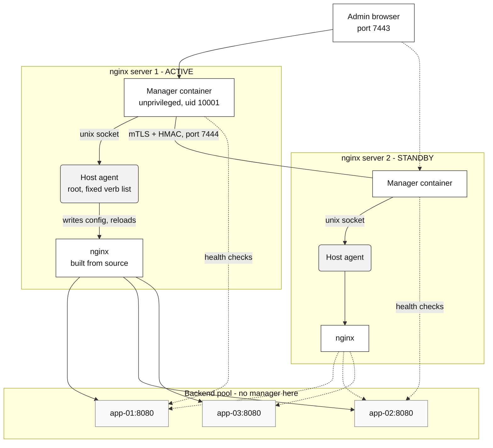
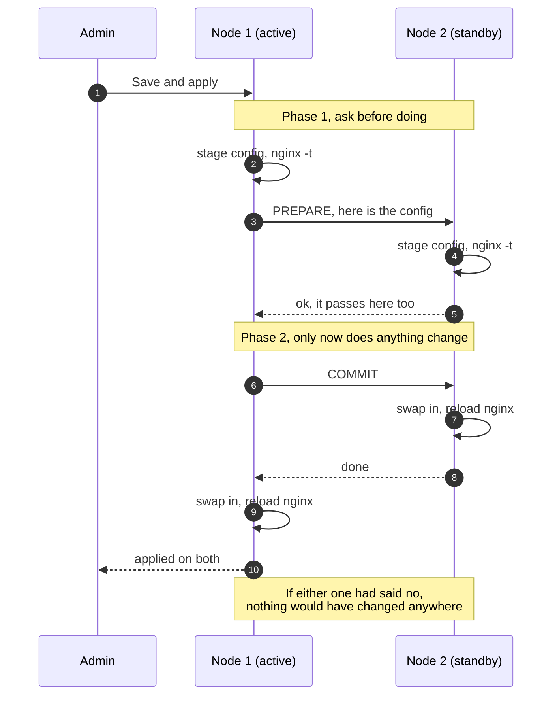
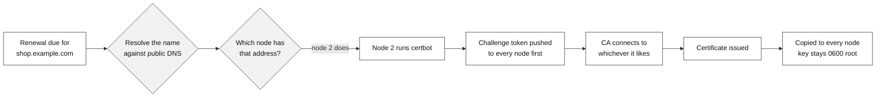

# Failover LB

A web GUI for running two or more NGINX&reg; boxes as one unit.  Sites, backend
pools with real health checks, and Lets Encrypt certificates that work properly
in a cluster.

It is built to sit on top of nginx built from source by `nginx-installer.sh`,
which ships in this folder, and it follows that layout: sites in their own
files, certbot in webroot mode, no distro nginx package anywhere near the
binary.

## What it does

**Runs your whole fleet as one thing.**  Every box runs the same container.  One
is ACTIVE and takes the writes, the rest stay in sync and can take over.  There
is no separate controller to lose.

**Never lets a bad config out.**  Every change is staged and run through
`nginx -t` on every node *before* any node applies it.  If one node says no,
nothing changes anywhere.  If a node fails during the apply, the whole fleet
rolls back together.  A pooched config cannot stop nginx from starting.

**Does not forget a node that was down.**  A box that was offline during a
change gets the change written into its queue and is caught up when it comes
back, so it never quietly drifts.

**Health checks your backends for real.**  The free nginx only notices a dead
backend after a user already got the error.  This probes every backend on a
schedule from every node, and rewrites the upstream with the bad one marked
down.  That is the paid version's headline feature, done from out here.

**Gets certificates right in a cluster.**  This is the fiddly one.  Only the
node that currently owns the public address can answer an http-01 challenge,
and which node that is changes when you fail over.  So we work it out fresh at
every renewal, run certbot there, and copy the files to everybody else.  The
challenge token goes to every node before validation starts, so it does not
matter which one Lets Encrypt actually connects to.

**Only offers what your nginx can actually do.**  It reads `nginx -V` off each
box and works out which modules are compiled in.  Settings for a module you do
not have are simply not there.  Paid-only features are not offered at all, and
where there is a free way to get the same result, the help text says what it is.

## What is here right now

This is a work in progress.  Being straight about where it is:

### Built

| Piece | File | What it is |
|---|---|---|
| Host agent | `host-agent/nginx-mgr-agent.py` | The root daemon.  Fixed verb list, path allow list, staged apply with rollback. |
| Agent hardening | `host-agent/nginx-mgr-agent.service` | systemd unit that gives it root and takes nearly everything else away. |
| Data model | `app/models.py` | Nodes, sites, pools, members, certs, users, audit, config versions, change queue. |
| Feature catalog | `app/catalog/` | Every nginx setting we offer, with help text, examples, validation and OSS/Plus gating. |
| Config parser | `app/core/nginx_parser.py` | Real tokenizer and parser.  Reads hand edited config back into GUI settings. |
| Config renderer | `app/core/render.py` | Turns the database into nginx config files. |
| Health checker | `app/core/health.py` | Active checks, slow start, adaptive weighting. |
| Cluster | `app/core/cluster.py` | Trust group, election with quorum, two phase apply, change queue. |
| Certificates | `app/core/acme.py` | Issuer selection, cluster wide challenge, replication, renewal scheduling. |
| nginx rebuild | `app/core/upgrade.py` | Drives the installer remotely.  Standbys first, active last, stops on the first failure. |
| Crypto | `app/core/crypto.py` | Cluster CA, node certs, secrets at rest, message signing. |
| Auth | `app/auth/` | Local break glass accounts with mandatory TOTP, plus OIDC with PKCE. |
| Web GUI and API | `app/web/` | Server rendered pages, JSON API, help modals, no build step. |
| nginx from source | `nginx-installer.sh` | Builds nginx with the modules, sets up certbot, keeps a rollback. |
| Docker setup | `docker_setup.sh` | Docker CE on Ubuntu 22.04+, done properly. |
| Per node install | `install.sh` | Agent, group, systemd unit, `.env`, container, cluster join. |
| One shot setup | `failoverlb_setup.sh` | Clone from git into `/data/docker/failoverlb` and hand off. |
| Plus parity notes | `docs/plus-parity.md` | Every paid feature, and what we built instead. |

The config parser has been run against realistic nginx config and correctly
handles the things that break naive parsers: `server` meaning two different
things depending on context, braces and semicolons inside quoted strings, and
round tripping without losing hand written directives.

GUI pages: Dashboard, Sites with a full editor, Backend Pools with an editor,
Zones and Access Lists, Certificates, Cluster, nginx Build, Open Source Parity,
Audit Log, My Account, Users, Settings.

### Still to come

| Piece | Notes |
|---|---|
| Real server testing | The big one.  Both installers exist but have never been run end to end. |
| Locations UI | The model and renderer already do path routing.  There is no UI for it. |
| Stream UI | Same story for TCP and UDP proxying. |
| Certificate upload | You can issue one from the GUI but not upload one you already have. |
| Monitoring dashboard | The log parsing dashboard in `docs/plus-parity.md` is not built. |
| Maps UI | Model and renderer support it, no UI. |

## Testing

The check suites and the applying test pass are internal testing rather than
part of the product, so they are not in this repository.  They live on the
machines that run them, under `checks/` and `tools/qa/`, and what they produce
is what ships: the user guide in `docs/`, the bill of materials in `sbom/`, and
the feature test plan handed over as a document.

Two things worth knowing if you are running this rather than reading it:

- The checks are meant to be run against a real installed fleet rather than a
  mock of one, on a node and inside the container, so they reach the agent and
  the same database the manager uses.
- The test pass applies configuration for real and then puts traffic through
  it.  That is the point of it, and it is why it must never be aimed at a fleet
  carrying real traffic.

## How the security works

Worth understanding before you install this anywhere.

**The container is not trusted.**  It runs as uid 10001, drops every capability,
and has a read only filesystem.  It cannot write `/etc/nginx` and it cannot
restart anything.

**The host agent is the boundary.**  It runs as root because the job needs root,
and it is deliberately small enough to read start to finish.  It accepts a fixed
list of verbs over a unix socket.  There is no "run this command" verb.  Every
path is resolved, symlinks and all, and checked against an allow list before
anything is touched.

**The peer port is not open.**  Three separate things have to line up: a client
certificate signed by this cluster's own CA and nothing else, a source address
on the node roster, and an HMAC signature made with a key only that node holds.
The timestamp and a nonce are inside the signed part, so a captured request
cannot be replayed.  A browser hitting that port gets nowhere.

**The GUI has its own allow list.**  `NFM_ADMIN_ALLOWLIST` is checked before the
login page even renders, so a stolen password from the wrong network still gets
nothing.

## Getting started

On a fresh box, all of it in one go:

```bash
sudo ./nginx-installer.sh install      # build nginx from source
sudo ./failoverlb_setup.sh             # docker, clone, install, start
```

The setup script clones into `/data/docker/failoverlb`, sets up docker if it
is missing, and hands off to `install.sh`.  Run it again any time to pull the
latest code and rebuild.  Your `.env` and your database are left alone.

The first admin password is printed to the log once:

```bash
docker compose logs | grep -A3 "Made the first admin"
```

To add a second node, log into the first one, go to Cluster, press Add a node,
and copy the token it gives you:

```bash
sudo ./failoverlb_setup.sh --join node-one:7444 --token <token>
```

Set `NFM_ADMIN_ALLOWLIST` in `.env` to your management networks before you put
this anywhere interesting.  Without it, anybody who can reach 7443 gets the
login page.

Certificates start pointed at the Lets Encrypt staging service on purpose.  The
real one locks you out for a week after five failures, and everybody gets it
wrong at least once.  Switch it in Settings once you have one working.

If you would rather do it by hand, `install.sh` is the per node half and takes
the same options.  Run `./install.sh --help`.

## How it fits together

**One manager container per nginx server.**  The container has to be on the same
box as the nginx it manages, because it talks to a root agent over a unix socket
on that machine.  There is no central controller to install and nothing to lose
if a box dies.

It does **not** go on your backend app servers.  Those are just servers in a
pool, and they never know the manager exists.



Solid lines are live traffic, dotted lines are standby or background work.  Both
nginx servers can serve, and both check the backends, but only the ACTIVE one
takes configuration changes.

### Who does what

| Piece | Runs where | Job |
|---|---|---|
| Manager container | every nginx server | The GUI, the database, health checks, talking to peers |
| Host agent | every nginx server | The only root part.  Writes config, tests it, reloads nginx |
| nginx | every nginx server | Serves the traffic |
| Your backends | wherever they already are | Nothing.  They do not know this exists |

### Applying a change

Nothing lands anywhere until every node agrees it is valid.



A node that is offline does not block the change.  It gets queued and replayed
when it comes back, so it catches up instead of quietly drifting.

### Certificates

Only the node that currently holds the public address can answer the challenge,
and that moves when you fail over.  So it is worked out fresh every time.



The token goes everywhere before validation starts because the CA picks which
address to connect to and we do not get a say.

## Adding more nodes

There is a join token.  It is made on a node that is already running, it works
once, and it expires in two hours.

On the running node, go to **Cluster** and press **Add a node**.  You get a
command to paste on the new box:

```bash
sudo git clone https://git.failoverlb.net/failoverlb.git /data/docker/failoverlb \
  && sudo /data/docker/failoverlb/failoverlb_setup.sh \
       --join 10.0.0.10:7444 --token <token>
```

If the code is already on that box, cd into the folder and run:

```bash
sudo ./failoverlb_setup.sh --join 10.0.0.10:7444 --token <token>
```

Build nginx on the new box first with `nginx-installer.sh install`.  The manager
manages an nginx, it does not bring its own.

### What actually happens

1. The new node makes a key pair and a signing request.  **The private key never
   leaves that box.**
2. It sends the request and the token to the node you pointed it at.
3. That node checks the token, signs the request, and sends back the new node's
   certificate, the cluster CA, and a shared key for signing messages.
4. The new node asks for the rest of the roster, so it learns about every other
   member and not just the one it joined through.

After that, three separate things have to line up on every peer call: a client
certificate signed by this cluster's own CA, a source address on the roster, and
an HMAC signature made with a key only that node holds.

Only the token is a shared secret, and only for those two hours.  There is no
long lived cluster password to leak.  Tokens are stored hashed, so a copy of the
database does not hand anybody a working one.

### Things worth knowing

- **The new node joins as a standby** and pulls the current config from the
  cluster.  You do not set your sites up twice.
- **Port 7444 has to be open between nodes**, and should be open nowhere else.
- **Every node needs its own `.env`.**  Do not copy one between boxes.  The
  secret key in it encrypts that node's TOTP seeds and peer keys.
- **A node that already has its own cluster will refuse to join another one**
  rather than silently throw your config away.
- **Priority decides who goes active.**  Higher wins.  A node will not make
  itself active unless it can see more than half the fleet, so a network split
  cannot leave you with two nodes both taking writes.

## Backend trust

Your app servers sit on a port somewhere.  Anything that can reach that port can
talk to them, and it looks the same to the app as nginx does.  A pool token is
how the backend tells the difference.

Turn it on per pool from **Backend trust** on the pool page.  nginx then puts a
shared secret on every request it proxies there:

```nginx
proxy_set_header X-Fleet-Token "k7Rm...9wQ2";
proxy_hide_header X-Fleet-Token;
```

Your backend checks it and returns 403 to anything else.  The GUI gives you the
snippet for nginx, Apache, Express, Django or Spring, so it is a paste rather
than a project.

- The header is **set**, not added, so a client sending that header itself has it
  thrown away and replaced.  You cannot forge your way in from outside.
- The health checker sends it too.  Without that, the moment a backend started
  enforcing it every check would come back 403 and a healthy pool would get
  marked down and pulled out of service.
- The secret is stored encrypted, and only shown when you ask for it.

**It is a bearer secret**, so it belongs behind a firewall rather than instead of
one.  Anybody holding it can pretend to be the fleet.  If the hop to your backend
crosses a network you do not trust, run that hop over TLS as well.

### Rotating without an outage

You cannot change both ends at the same instant, and nginx can only send one
value, so it takes two steps.

1. **Rotate.**  A new token is generated but nginx keeps sending the old one, so
   nothing changes on the wire.  Add the new one to your backends so they accept
   either.
2. **Activate.**  nginx starts sending the new one, which your backends already
   take.  Apply the config, watch traffic, then delete the old one.

Doing it in one step means every request in the gap gets a 403.  Turning it off
is the same idea in reverse: apply the config first, then stop checking for it.

## Layout

```
failoverlb/
├── app/
│   ├── catalog/          every setting, with its help text and rules
│   ├── core/             the engine: cluster, health, certs, render, parse
│   ├── models.py         database tables
│   ├── config.py         settings from the environment
│   └── db.py             sqlite setup
├── host-agent/           the root daemon, runs outside the container
├── docs/                 plus-parity.md and friends
├── docker_setup.sh       Docker CE on Ubuntu
├── docker-compose.yml
├── Dockerfile
└── .env.example
```

## Ports

| Port | What |
|---|---|
| 7443 | The web GUI |
| 7444 | Node to node.  Needs a cluster certificate.  Firewall it to your peers. |
| 7081 | `stub_status`, bound to localhost only, for the dashboard |

## Why sqlite

Every node keeps its own full copy of the config and the nodes sync to each
other.  Adding postgres would mean one more thing that has to be up before you
can manage your load balancers, which is exactly backwards.  When something is
broken at 3am you still need to get in and fix nginx.

## Trademarks

NGINX&reg; is a registered trademark of F5, Inc.  NGINX Plus is a trademark of
F5, Inc.  Failover LB is an independent project and is not affiliated with,
endorsed by, or sponsored by F5, Inc.

NGINX is named here only to say what this software manages, which is what
nominative use is for.  Lower case `nginx` in these pages and in the GUI means
the binary, the config file or the command, not the mark: `nginx -t` is a
command you type, NGINX is the product it belongs to.

The software was called NGINX Management until August 2026 and was renamed for
this reason.  Nothing in the product name refers to NGINX any more.
